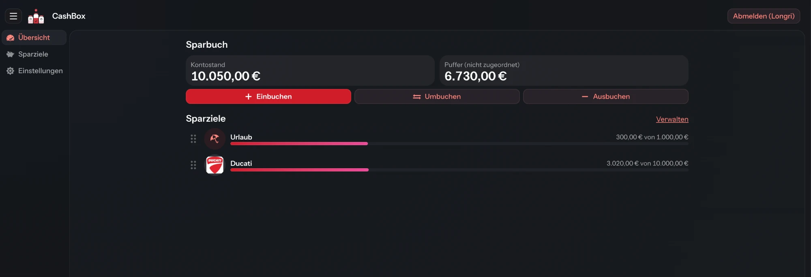
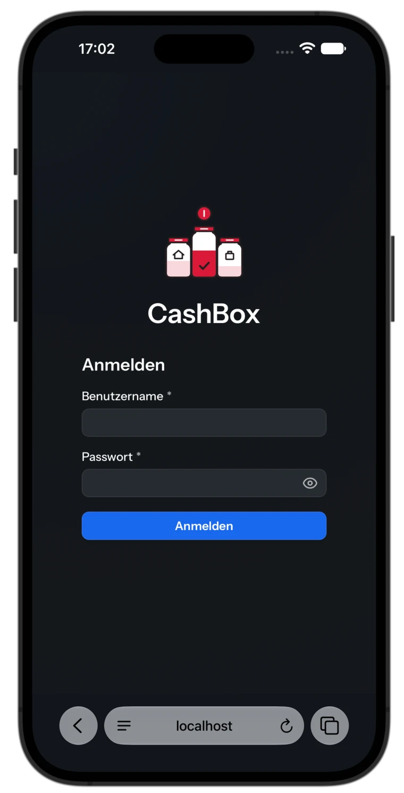
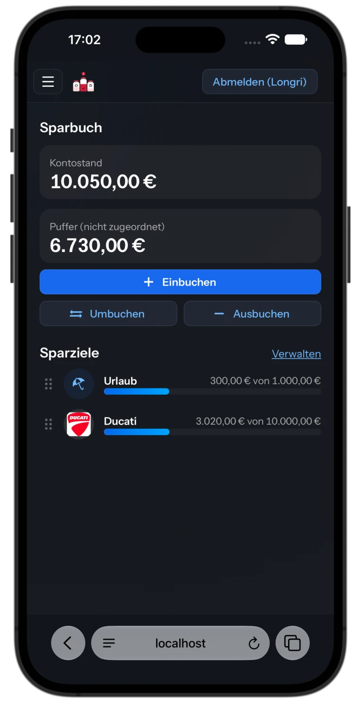
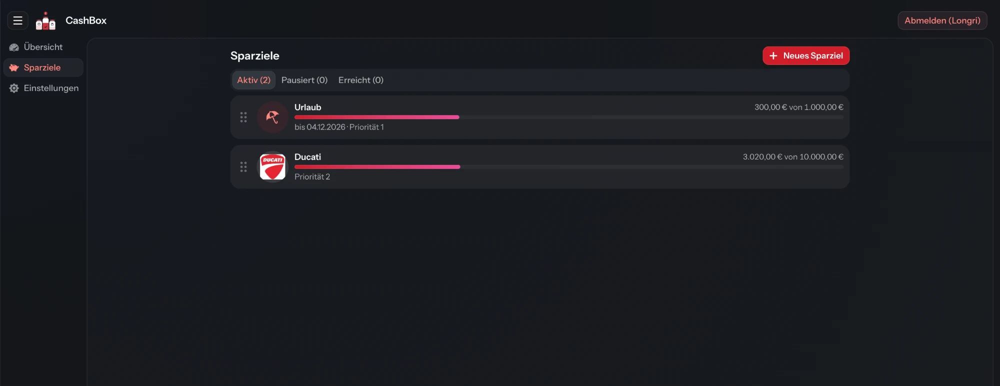
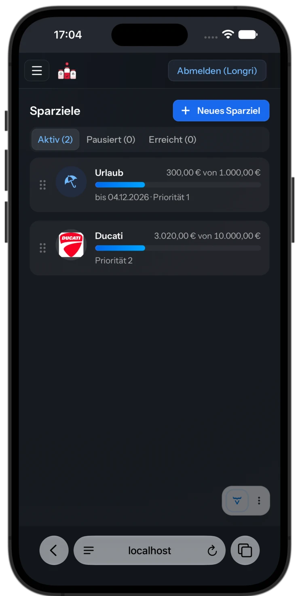
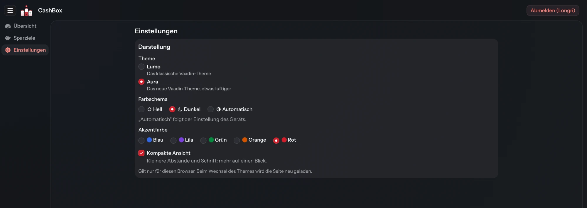
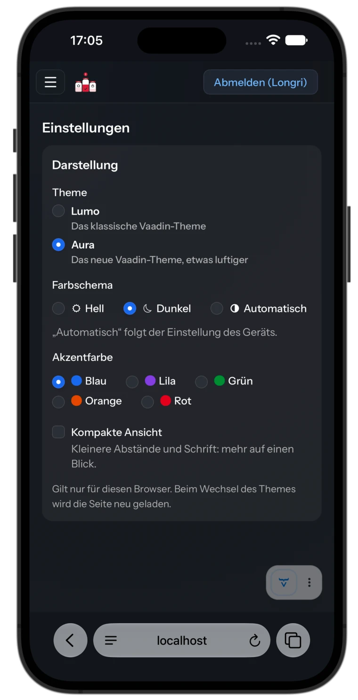

# CashBox – Handbuch

Version 1.0.1 · Stand: November 2026

CashBox verteilt das Guthaben eines echten Sparkontos auf virtuelle Spartöpfe, die Sparziele.
So sieht man jederzeit, wie viel Geld auf dem Sparbuch wofür gedacht ist und was noch frei ist.
Dieses Handbuch beschreibt die Installation auf einem Server, den Betrieb und die Bedienung.

<p align="center">
  
</p>

## Inhalt

1. [Überblick](#1-überblick)
2. [Installation](#2-installation)
3. [Betrieb und Wartung](#3-betrieb-und-wartung)
4. [Erste Schritte](#4-erste-schritte)
5. [Die Oberfläche](#5-die-oberfläche)
6. [Übersicht](#6-übersicht)
7. [Buchen](#7-buchen)
8. [Sparziele verwalten](#8-sparziele-verwalten)
9. [Einstellungen](#9-einstellungen)
10. [Benutzer verwalten (Admin)](#10-benutzer-verwalten-admin)
11. [Typische Abläufe](#11-typische-abläufe)
12. [Fragen und Fehlermeldungen](#12-fragen-und-fehlermeldungen)
13. [Anhang: Entwicklung](#13-anhang-entwicklung)

---

## 1. Überblick

### 1.1 Die Idee

Auf einem Sparbuch liegt ein Betrag, aber das Konto sagt nicht, wofür er gedacht ist. CashBox teilt
den Kontostand in Gedanken auf: ein Teil für den Urlaub, ein Teil für das Motorrad, der Rest als
Reserve. Auf dem echten Konto wird dabei nichts bewegt. CashBox führt nur Buch darüber, welcher Betrag
wofür vorgesehen ist.

### 1.2 Begriffe

| Begriff | Bedeutung |
|---|---|
| **Sparkonto** | Das eine echte Konto, in CashBox „Sparbuch“ genannt. |
| **Kontostand** | Was auf dem echten Sparkonto liegt. Er sollte immer mit dem Kontoauszug übereinstimmen. |
| **Sparziel** | Ein virtueller Topf mit Name und Zielbetrag, auf Wunsch mit Zieldatum, Priorität, Beschreibung und Symbol oder Bild. |
| **Puffer** | Geld auf dem Konto, das noch keinem Sparziel zugeordnet ist. |
| **Buchung** | Jede Geldbewegung: Einbuchen, Umbuchen oder Ausbuchen. Sie wird dauerhaft gespeichert und lässt sich nicht ändern oder löschen. |
| **Status** | *Aktiv*, *Pausiert* oder *Erreicht*. Davon hängt ab, ob ein Sparziel neues Geld bekommen darf. |

### 1.3 Die Grundregel

```
Kontostand = Puffer + Summe aller Sparziele
```

Beispiel aus dem Bild oben: 10.050,00 € Kontostand = 6.730,00 € Puffer + 300,00 € (Urlaub) +
3.020,00 € (Ducati).

CashBox prüft diese Regel bei jeder Buchung. Eine Buchung, die sie verletzen würde, wird verworfen.
Die Datenbank verhindert außerdem negative Beträge.

### 1.4 Ein Konto für alle Benutzer

Es gibt genau ein Sparkonto. Alle Benutzer sehen und bearbeiten dasselbe Konto mit denselben
Sparzielen, CashBox passt also z. B. zu einem Haushalt mit gemeinsamem Sparbuch. Der Admin kann
zusätzlich Benutzer anlegen und löschen. Nur die Darstellung (Theme, Farben, kompakte Ansicht)
stellt jeder Browser für sich ein.

---

## 2. Installation

CashBox läuft als Docker-Container zusammen mit einer MariaDB-Datenbank. Das fertige Image
`ghcr.io/longri/cashbox` gibt es für:

- `linux/amd64`: normale Server und PCs
- `linux/arm64`: z. B. Raspberry Pi oder NAS mit 64-Bit-System

### 2.1 Voraussetzungen

- Ein Rechner mit Docker und dem Compose-Plugin. Prüfen mit:

  ```bash
  docker compose version
  ```

  Falls der Befehl fehlt: [Docker installieren](https://docs.docker.com/engine/install/).
- Für den Zugriff aus dem Internet zusätzlich eine Domain, die auf den Server zeigt, und offene
  Ports 80 und 443 (siehe [2.6](#26-aus-dem-internet-erreichbar-machen-https)).

### 2.2 Ordner anlegen und Dateien holen

Auf dem Server braucht man nur zwei Dateien aus dem Ordner [`deploy/`](../deploy):

```bash
mkdir cashbox && cd cashbox
curl -fsSLO https://raw.githubusercontent.com/Longri/CashBox/main/deploy/docker-compose.yml
curl -fsSL -o .env https://raw.githubusercontent.com/Longri/CashBox/main/deploy/.env.example
chmod 600 .env
```

`chmod 600` sorgt dafür, dass nur der eigene Benutzer die Passwörter in der `.env` lesen kann.

### 2.3 Einstellungen in der `.env`

```bash
nano .env
```

| Variable | Bedeutung | Vorgabe |
|---|---|---|
| `ADMIN_USER` | Benutzername des Admins. Der Admin steht nicht in der Datenbank, sondern nur hier. | `admin` |
| `ADMIN_PASSWORD` | Passwort des Admins | *ändern!* |
| `DB_PASSWORD` | Passwort, mit dem die Anwendung auf die Datenbank zugreift | *ändern!* |
| `DB_ROOT_PASSWORD` | Root-Passwort der Datenbank | *ändern!* |
| `REMEMBER_ME_DAYS` | So viele Tage bleibt man nach dem Anmelden angemeldet. `0` = bei jeder neuen Sitzung anmelden. | `14` |
| `CASHBOX_PORT` | Port, unter dem CashBox erreichbar ist | `8080` |
| `CASHBOX_VERSION` | `latest` oder eine feste Version wie `1.0.1` | `latest` |
| `TZ` | Zeitzone der Anwendung | `Europe/Berlin` |

Alle drei Passwörter ändern. Ein sicheres Passwort erzeugt z. B.:

```bash
openssl rand -hex 24
```

Enthält ein Wert ein `$`, gehört er in einfache Anführungszeichen: `ADMIN_PASSWORD='pa$$wort'`.

> **Wichtig:** `DB_PASSWORD` und `DB_ROOT_PASSWORD` werden beim ersten Start in die neue Datenbank
> geschrieben. Ändert man sie später nur in der `.env`, passt die Datenbank nicht mehr dazu und die
> Anwendung kann sich nicht verbinden. Die `.env` daher gut aufbewahren, am besten zusammen mit den
> Backups.

Fehlt ein Pflichtwert, bricht `docker compose` mit einer Meldung wie
`DB_PASSWORD in .env setzen` ab.

### 2.4 Starten

```bash
docker compose up -d
```

Beim ersten Start lädt Docker die Images, die Datenbank richtet sich ein und die Anwendung legt
ihre Tabellen und das Konto „Sparbuch“ an. Den Stand zeigen:

```bash
docker compose ps
```

```bash
docker compose logs -f app
```

CashBox ist bereit, sobald im Log `Started Application` steht. Die Anzeige beendet man mit
`Strg+C`, CashBox läuft dabei weiter.

Die Container starten nach einem Neustart des Servers automatisch wieder (`restart: unless-stopped`).
Die Datenbank ist von außen nicht erreichbar, nur die Anwendung kann sie ansprechen.

### 2.5 Erste Anmeldung

1. Im Browser `http://<server>:8080` öffnen.
2. Mit `ADMIN_USER` und `ADMIN_PASSWORD` anmelden.
3. Unter **Benutzer** weitere Benutzer anlegen (siehe [Kapitel 10](#10-benutzer-verwalten-admin)).
4. Weiter mit den [ersten Schritten](#4-erste-schritte).

Admin-Passwort ändern: neuen Wert in die `.env` schreiben und

```bash
docker compose up -d
```

ausführen. Der Container wird dann mit dem neuen Passwort neu erstellt.

### 2.6 Aus dem Internet erreichbar machen (HTTPS)

CashBox selbst spricht nur HTTP. Ohne HTTPS gingen Passwort und Anmelde-Cookie im Klartext übers
Netz. Deshalb gehört ein Reverse-Proxy davor, z. B. [Caddy](https://caddyserver.com), der sich die
Zertifikate selbst besorgt.

1. In der `.env` CashBox nur noch lokal erreichbar machen, damit niemand am Proxy vorbeikommt:

   ```
   CASHBOX_PORT=127.0.0.1:8080
   ```

2. Übernehmen:

   ```bash
   docker compose up -d
   ```

3. Im `Caddyfile` des direkt auf dem Server installierten Caddy:

   ```
   cashbox.example.de {
       reverse_proxy localhost:8080
   }
   ```

Die mitgelieferte `docker-compose.yml` wertet die Weiterleitungs-Header des Proxys bereits aus, damit
Weiterleitungen und Cookies HTTPS verwenden. Ohne Proxy schadet diese Einstellung nicht.

### 2.7 Als App auf den Home-Bildschirm legen

CashBox bringt ein Web-App-Manifest und ein Icon mit und lässt sich wie eine App auf den
Home-Bildschirm legen. Voraussetzung ist HTTPS (siehe [2.6](#26-aus-dem-internet-erreichbar-machen-https)).

- **iPhone/iPad:** In Safari oder ab iOS 16.4 auch in Chrome: Teilen-Symbol → „Zum Home-Bildschirm“
  → „Hinzufügen“. Ab iOS 26 den Schalter „Als Web-App öffnen“ eingeschaltet lassen.
- **Android:** Im Chrome-Menü „App installieren“ oder „Zum Startbildschirm hinzufügen“.

Das Icon öffnet CashBox dann ohne Adressleiste. Die App vom Home-Bildschirm hat eigene Cookies,
getrennt vom Browser. Man meldet sich dort also einmal an und stellt die
[Darstellung](#9-einstellungen) bei Bedarf neu ein.

---

## 3. Betrieb und Wartung

Alle Befehle in diesem Kapitel im Ordner mit der `docker-compose.yml` ausführen.

### 3.1 Update auf eine neue Version

Vorher ein [Backup](#33-backup) machen, dann:

```bash
docker compose pull && docker compose up -d
```

Neue Datenbankänderungen spielt die Anwendung beim Start selbst ein. Mit `CASHBOX_VERSION=latest`
kommt immer die neueste Version. Mit einer festen Nummer (z. B. `1.0.1`) bleibt es bei dieser, bis man
sie in der `.env` ändert.

### 3.2 Stoppen und Starten

```bash
docker compose stop
```

```bash
docker compose start
```

`docker compose down` entfernt die Container, die Daten bleiben erhalten.

> **Achtung:** `docker compose down -v` löscht zusätzlich die Datenbank mit allen Daten.

### 3.3 Backup

Schreibt den kompletten Datenstand in eine Datei, ohne CashBox anzuhalten:

```bash
docker compose exec -T db sh -c 'mariadb-dump --single-transaction -ucashbox -p"$MARIADB_PASSWORD" cashbox' > cashbox-$(date +%F).sql
```

Automatisch jede Nacht um 2:30 Uhr per `crontab -e`. Den Ordner `backup` vorher anlegen und den Pfad
anpassen. In der Crontab muss `%` als `\%` stehen:

```
30 2 * * * cd /pfad/zu/cashbox && docker compose exec -T db sh -c 'mariadb-dump --single-transaction -ucashbox -p"$MARIADB_PASSWORD" cashbox' > backup/cashbox-$(date +\%F).sql
```

Backups zusätzlich auf einem anderen Gerät ablegen, zusammen mit einer Kopie der `.env`.

### 3.4 Wiederherstellen

Ersetzt den aktuellen Datenstand komplett durch den aus der Sicherung:

```bash
docker compose stop app
```

```bash
docker compose exec -T db sh -c 'mariadb -ucashbox -p"$MARIADB_PASSWORD" cashbox' < cashbox-2026-11-08.sql
```

```bash
docker compose start app
```

### 3.5 Logs ansehen

```bash
docker compose logs -f app
```

Meldet die Oberfläche einen „technischen Fehler“, steht die genaue Ursache hier.

### 3.6 Konsistenz prüfen

Die Datenbank enthält eine Prüfansicht, die die [Grundregel](#13-die-grundregel) nachrechnet. Die Spalte
`difference` muss immer `0.00` sein:

```bash
docker compose exec -T db sh -c 'mariadb -ucashbox -p"$MARIADB_PASSWORD" cashbox -e "SELECT * FROM v_account_consistency"'
```

### 3.7 Automatische Aufräumarbeiten

Jede Nacht um 3:30 Uhr (Zeitzone aus `TZ`) löscht CashBox abgelaufene Anmelde-Tokens von
„Angemeldet bleiben“. Dafür ist nichts zu tun.

---

## 4. Erste Schritte

So kommt eine frische Installation in wenigen Minuten auf den echten Stand:

1. **Anmelden** mit dem Admin oder einem angelegten Benutzer.
2. **Sparziele anlegen:** Menü **Sparziele** → **Neues Sparziel**. Name und Zielbetrag reichen
   (siehe [8.2](#82-neues-sparziel-anlegen)).
3. **Aktuellen Kontostand einbuchen:** Menü **Übersicht** → **Einbuchen**. Als Betrag den heutigen
   Stand des echten Sparbuchs eingeben, bei „Zuordnen zu“ den **Puffer** lassen und buchen.
4. **Geld verteilen:** **Umbuchen** → „Von“ **Puffer** → „Nach“ das Sparziel → Betrag → buchen.
   Für jedes Sparziel wiederholen.

Danach stimmt der Kontostand in CashBox mit dem Kontoauszug überein, und der Puffer zeigt, was noch
frei ist. Neues Geld lässt sich beim Einbuchen auch gleich einem Sparziel zuordnen.

---

## 5. Die Oberfläche

### 5.1 Anmelden

<p align="center">
  
</p>

- **Benutzername** und **Passwort** eingeben, dann **Anmelden**. Groß- und Kleinschreibung spielt
  beim Benutzernamen keine Rolle, beim Passwort schon.
- Bei falschen Daten erscheint „Benutzername oder Passwort ist falsch.“
- Eine Funktion „Passwort vergessen“ gibt es nicht. Ein neues Passwort vergibt der Admin
  (siehe [10.3](#103-passwort-ändern)).

**Angemeldet bleiben:** Jede Anmeldung wird automatisch gemerkt, standardmäßig 14 Tage lang
(`REMEMBER_ME_DAYS`). Bis dahin öffnet sich CashBox in diesem Browser ohne neue Anmeldung. Mit
`REMEMBER_ME_DAYS=0` muss man sich bei jeder neuen Sitzung anmelden.

### 5.2 Aufbau

| Bereich | Inhalt |
|---|---|
| Kopfzeile links | **☰** blendet das Menü ein und aus, daneben Logo und „CashBox“ (auf schmalen Bildschirmen nur das Logo) |
| Kopfzeile rechts | **Abmelden (Name)** zeigt, wer angemeldet ist, und meldet ab |
| Menü | **Übersicht**, **Sparziele**, **Benutzer** (nur Admin), **Einstellungen** |

Auf dem Handy ist das Menü eingeklappt und öffnet sich über **☰**.

### 5.3 Abmelden

Ein Klick auf **Abmelden (Name)** beendet die Sitzung und löscht das „Angemeldet bleiben“ dieses
Benutzers auf **allen** Geräten. Andere Geräte bleiben nur noch bis zum Ende ihrer laufenden Sitzung
angemeldet und verlangen danach eine neue Anmeldung.

### 5.4 Beträge eingeben

- Dezimaltrenner: Komma **oder** Punkt (`12,50` oder `12.50`).
- Höchstens zwei Nachkommastellen.
- **Keine Tausenderpunkte:** `1000,50` statt `1.000,50`. Aus `1.000` würde sonst 1,000 € mit drei
  Nachkommastellen, das CashBox ablehnt.
- Der Betrag muss größer als 0 und kleiner als 1 Milliarde sein.
- Auf dem Smartphone erscheint automatisch der Ziffernblock.

Angezeigt werden Beträge im deutschen Format, z. B. `3.020,00 €`.

### 5.5 Dialoge

Buchungen und Sparziele werden in Dialogen bearbeitet. Auf dem Handy füllen sie den ganzen Bildschirm.

- **Enter** speichert direkt aus den einzeiligen Eingabefeldern heraus.
- **Esc** oder **✕** schließt den Dialog ohne zu speichern, ebenso **Abbrechen**.
- Ein Klick neben den Dialog schließt ihn **nicht**, damit Eingaben nicht versehentlich verloren gehen.
- Fehler erscheinen als rote Leiste oben im Dialog oder direkt unter dem betroffenen Feld.
- Nach dem Speichern erscheint unten kurz eine Erfolgsmeldung, z. B. „250,00 € eingebucht“.

---

## 6. Übersicht

Die Startseite nach der Anmeldung.

<p align="center">
  
</p>
<p align="center">
  
</p>

| Element | Bedeutung |
|---|---|
| Überschrift „Sparbuch“ | Name des Sparkontos |
| **Kontostand** | Was auf dem echten Sparkonto liegt |
| **Puffer (nicht zugeordnet)** | Geld, das noch keinem Sparziel gehört |
| **Einbuchen**, **Umbuchen**, **Ausbuchen** | Öffnen den [Buchungsdialog](#7-buchen) mit dem passenden Reiter |
| **Sparziele** | Alle **aktiven** Sparziele mit Symbol, Name, „zugeordnet von Zielbetrag“ und Fortschrittsbalken |
| **Verwalten** | Wechselt zur Seite [Sparziele](#8-sparziele-verwalten) |
| **⠿** links neben einem Ziel | Griff zum Umsortieren (siehe [8.6](#86-reihenfolge-und-priorität)) |

Ein Tipp auf ein Sparziel öffnet die Seite **Sparziele**. Pausierte und erreichte Ziele erscheinen
nicht auf der Übersicht, nur auf der Sparziel-Seite. Gibt es noch kein Sparziel oder kein aktives,
führt ein Link dorthin.

Der Fortschrittsbalken zeigt den Anteil am Zielbetrag. Hat ein Ziel mehr Geld als den Zielbetrag,
bleibt der Balken voll.

---

## 7. Buchen

Jede Geldbewegung ist eine von drei Buchungsarten:

| Buchungsart | Was passiert | Kontostand | Beispiel |
|---|---|---|---|
| **Einbuchen** | Geld kommt auf das Sparkonto | steigt | Sparrate, Zinsen, Geldgeschenk |
| **Umbuchen** | Geld wandert zwischen Puffer und Sparzielen | bleibt gleich | 200 € aus dem Puffer für den Urlaub zurücklegen |
| **Ausbuchen** | Geld verlässt das Sparkonto | sinkt | Urlaub bezahlt, Geld abgehoben |

### 7.1 Der Buchungsdialog

Die Buttons **Einbuchen**, **Umbuchen** und **Ausbuchen** auf der Übersicht öffnen denselben Dialog
„Buchung“. Oben wechselt man jederzeit zwischen den drei Reitern. Darunter erklärt ein Hinweistext,
was die gewählte Buchungsart tut oder warum sie gerade nicht möglich ist.

Sobald Betrag und Auswahl vollständig sind, zeigt eine **Vorschau**, wie sich die Beträge ändern
(z. B. `Puffer 6.730,00 € → 6.530,00 €`). Der Button unten nennt den Betrag gleich mit, z. B.
**200,00 € umbuchen**.

Das Feld **Notiz (optional)** nimmt bis zu 255 Zeichen auf, z. B. „Sparrate November“. Die Notiz wird
mit der Buchung gespeichert.

### 7.2 Einbuchen

| Feld | Bedeutung |
|---|---|
| **Betrag** | Wie viel Geld auf das Sparkonto kommt |
| **Zuordnen zu** | **Puffer** (vorausgewählt) oder ein **aktives** Sparziel. Pausierte und erreichte Ziele sind ausgegraut. |
| **Notiz** | optional |

Die Vorschau zeigt den neuen Kontostand und den neuen Stand von Puffer bzw. Sparziel. Wählt man ein
Sparziel, landet das Geld zuerst im Puffer und wird im selben Schritt weitergebucht. In der
Historie stehen dann zwei Buchungen: die Einzahlung und die Umbuchung.

### 7.3 Umbuchen

| Feld | Bedeutung |
|---|---|
| **Betrag** | Wie viel verschoben wird. Darunter steht, wie viel in der Quelle verfügbar ist. |
| **Alles** | Übernimmt den gesamten verfügbaren Betrag der Quelle |
| **Von** | Puffer oder ein beliebiges Sparziel mit Geld, auch pausierte und erreichte (mit „(Pausiert)“ bzw. „(Erreicht)“ gekennzeichnet). Töpfe ohne Geld sind ausgegraut. |
| **⇅** | Tauscht „Von“ und „Nach“. Gesperrt, wenn die Quelle pausiert oder erreicht ist, denn die würde sonst zum Ziel. |
| **Nach** | Puffer oder ein **aktives** Sparziel; die gewählte Quelle ist ausgegraut |
| **Notiz** | optional |

Der Kontostand ändert sich beim Umbuchen nicht. Nicht möglich ist das Umbuchen, solange

- es noch kein Sparziel gibt (der Hinweis enthält dann den Link **Sparziel anlegen**),
- noch kein Geld vorhanden ist, oder
- das Geld nur im Puffer liegt und es kein aktives Sparziel gibt, auf das umgebucht werden könnte
  (Link **Sparziele verwalten**).

### 7.4 Ausbuchen

Geld verlässt das Sparkonto, z. B. weil es ausgegeben wurde.

| Quelle („Von“) | Betrag | Besonderheit |
|---|---|---|
| **Puffer** | beliebig bis zum Pufferstand; **Alles** übernimmt den ganzen Puffer | – |
| **Sparziel** | **immer der komplette Inhalt**. Der Betrag wird eingetragen und ist nicht änderbar. | Kästchen **Sparziel danach als „Erreicht“ markieren** (vorausgewählt) |

Beim Ausbuchen eines Sparziels zeigt die Vorschau auch den Statuswechsel, z. B. `Aktiv → Erreicht`.
Ist das Ziel schon erreicht, fehlt das Kästchen. Ohne Haken behält das Ziel seinen Status und ist
danach leer.

Soll nur ein **Teil** eines Sparziels ausgegeben werden, bucht man diesen Teil zuerst in den Puffer um
und dann aus dem Puffer aus (siehe [11.4](#114-nur-einen-teil-eines-sparziels-ausgeben)).

### 7.5 Buchungen sind endgültig

Buchungen lassen sich nicht ändern oder löschen. Die Historie bleibt so lückenlos. Eine Fehlbuchung
korrigiert man mit einer Gegenbuchung (siehe [11.8](#118-eine-fehlbuchung-korrigieren)).

Die Oberfläche zeigt die Buchungshistorie derzeit nicht an. Sie steht in der Datenbank (Tabelle
`booking`) und ist im [Backup](#33-backup) enthalten. CashBox speichert nicht, welcher Benutzer eine
Buchung angelegt hat.

---

## 8. Sparziele verwalten

Menü **Sparziele** oder **Verwalten** auf der Übersicht.

<p align="center">
  
</p>
<p align="center">
  
</p>

### 8.1 Die Sparziel-Seite

- **Neues Sparziel** oben rechts legt ein Ziel an.
- Die Reiter **Aktiv**, **Pausiert** und **Erreicht** zeigen die Ziele nach Status, in Klammern die
  Anzahl.
- Jede Karte zeigt Symbol oder Bild, Name, „zugeordnet von Zielbetrag“, Fortschrittsbalken und
  darunter, falls vorhanden, „Zielbetrag erreicht“, Zieldatum und Priorität sowie die Beschreibung.
- Ein Klick auf eine Karte öffnet den Dialog **Sparziel bearbeiten**.
- **⠿** links ist der Griff zum Umsortieren (siehe [8.6](#86-reihenfolge-und-priorität)).

Ein neu angelegtes Ziel ist aktiv. Die Seite wechselt danach auf den Reiter **Aktiv**, damit es zu
sehen ist.

### 8.2 Neues Sparziel anlegen

**Neues Sparziel** öffnet den Dialog:

| Feld | Pflicht | Hinweise |
|---|---|---|
| **Symbol** (rund, links neben dem Namen) | – | Standard ist das Sparschwein. Ein Klick darauf öffnet die Auswahl (siehe [8.4](#84-symbol-oder-eigenes-bild)). |
| **Name** | ja | höchstens 100 Zeichen; jeder Name nur einmal, Groß- und Kleinschreibung zählt dabei nicht |
| **Zielbetrag** | ja | größer als 0 |
| **Zieldatum (optional)** | – | Bis wann das Geld zusammen sein soll. Format TT.MM.JJJJ oder über den Kalender. Bei neuen Zielen nicht in der Vergangenheit. |
| **Priorität (optional)** | – | 1 bis 999, 1 = am wichtigsten. Bestimmt die Reihenfolge. |
| **Beschreibung (optional)** | – | bis zu 2.000 Zeichen für Details, Links, Gedanken |

**Anlegen** speichert. Das neue Ziel ist aktiv und leer (0,00 €). Geld bekommt es über
[Einbuchen oder Umbuchen](#7-buchen). Im Sparziel-Dialog selbst wird nie Geld bewegt.

### 8.3 Sparziel bearbeiten

Ein Klick auf die Karte öffnet denselben Dialog mit den gespeicherten Werten und zusätzlich:

- Unter **Zielbetrag** steht, wie viel bereits zugewiesen ist. Der Zielbetrag lässt sich jederzeit
  ändern, das zugewiesene Geld bleibt dabei unverändert.
- **Status**: Aktiv, Pausiert oder Erreicht (siehe [8.5](#85-status)).
- Hat ein aktives Ziel den Zielbetrag erreicht, erscheint der Hinweis „Der Zielbetrag ist erreicht.
  Du kannst das Ziel als „Erreicht“ markieren.“
- **Löschen**, falls möglich (siehe [8.7](#87-löschen)).

**Speichern** übernimmt alle Änderungen, auch ein neues Symbol oder Bild.

### 8.4 Symbol oder eigenes Bild

Ein Klick auf das runde Symbol mit dem Stift öffnet den Dialog **Symbol wählen**.

**Eigenes Bild**

1. **Bild hochladen** oder eine Datei auf die Fläche ziehen. Möglich sind JPG, PNG oder GIF bis 15 MB.
2. Danach öffnet sich **Ausschnitt wählen**:
   - Ziehen verschiebt das Bild.
   - Zoomen mit dem Regler, dem Mausrad oder mit zwei Fingern. Herausgezoomt passt auch ein ganzes
     Logo in den Kreis, der Rand bleibt dann durchsichtig.
   - Der Kreis zeigt, was später angezeigt wird.
3. **Übernehmen**.

Hat das Ziel bereits ein Bild, bietet der Dialog zusätzlich **Ausschnitt ändern** (ohne neuen Upload)
und **Anderes Bild hochladen**. CashBox dreht Handyfotos automatisch richtig und verkleinert sie.

**Oder ein Symbol**

Darunter stehen 44 Standardsymbole, z. B. Sparschwein, Tresor, Regenschirm, Zuhause, Auto, Flugzeug,
Koffer, Weltreise, Geschenk, Kind, Ausbildung, Computer, Kamera, Musik, Gesundheit, Brille, Feier,
Großes Ziel. Der Name erscheint, wenn man mit der Maus darüberfährt. Ein Symbol ersetzt ein
vorhandenes eigenes Bild.

> Symbol und Bild werden erst gespeichert, wenn man im Sparziel-Dialog **Anlegen** bzw.
> **Speichern** klickt. **Abbrechen** verwirft die Auswahl.

### 8.5 Status

| | Aktiv | Pausiert | Erreicht |
|---|:---:|:---:|:---:|
| Bekommt neues Geld (Einbuchen, Umbuchen „Nach“) | ✔ | – | – |
| Geld herausnehmen (Umbuchen „Von“) | ✔ | ✔ | ✔ |
| Komplett ausbuchen | ✔ | ✔ | ✔ |
| Auf der Übersicht sichtbar | ✔ | – | – |

- **Pausiert**: für Ziele, die gerade ruhen sollen. Bereits zugewiesenes Geld bleibt darin.
- **Erreicht**: für abgeschlossene Ziele. Restgeld kann zurück in den Puffer gebucht werden.
- Den Status ändert man im Dialog **Sparziel bearbeiten**. Beim kompletten Ausbuchen setzt CashBox ihn
  auf Wunsch automatisch auf **Erreicht**.
- Das Erreichen des Zielbetrags allein ändert den Status nicht. Die Karte zeigt dann
  „Zielbetrag erreicht“.

Soll ein pausiertes oder erreichtes Ziel wieder Geld bekommen, setzt man es zuerst auf **Aktiv**.

### 8.6 Reihenfolge und Priorität

Innerhalb eines Reiters stehen die Ziele nach Priorität (1 zuerst), dann die ohne Priorität, jeweils
alphabetisch nach Name.

Die Reihenfolge lässt sich am Griff **⠿** links ändern. Er erscheint, sobald mindestens zwei Ziele in
der Liste stehen.

- **Maus oder Finger:** Griff anfassen und nach oben oder unten ziehen. **Esc** bricht das Ziehen ab.
- **Tastatur:** mit **Tab** auf den Griff, dann **↑** oder **↓**.

Verschoben wird nur innerhalb desselben Status. Nach dem Ablegen nummeriert CashBox die Prioritäten
aller Ziele dieses Status neu (1, 2, 3 …), auch die von Zielen, die vorher keine Priorität hatten.
Das Sortieren funktioniert genauso auf der Übersicht.

### 8.7 Löschen

Löschen lässt sich nur ein Sparziel, das **leer** ist und **noch nie eine Buchung** hatte, z. B. ein
versehentlich angelegtes. Dann gibt es im Dialog **Sparziel bearbeiten** unten links den Button
**Löschen**. Nach der Rückfrage „Sparziel löschen?“ ist das Ziel endgültig weg.

Alle anderen Ziele bleiben erhalten, damit die Buchungshistorie vollständig bleibt. Statt des Buttons
steht dann ein Hinweis im Dialog. Ziele, die man nicht mehr braucht, setzt man auf **Pausiert** oder
**Erreicht**.

---

## 9. Einstellungen

Menü **Einstellungen**, Abschnitt **Darstellung**.

<p align="center">
  
</p>
<p align="center">
  
</p>

| Einstellung | Auswahl | Wirkung |
|---|---|---|
| **Theme** | **Lumo** (das klassische Vaadin-Theme), **Aura** (das neue, etwas luftiger) | Die Seite lädt neu. |
| **Farbschema** | **Hell**, **Dunkel**, **Automatisch** | Sofort. „Automatisch“ folgt der Einstellung des Geräts, auch beim Umschalten. |
| **Akzentfarbe** | **Blau**, **Lila**, **Grün**, **Orange**, **Rot** | Sofort. Färbt Buttons, Links, Markierungen und Fortschrittsbalken. |
| **Kompakte Ansicht** | an / aus | Sofort. Kleinere Abstände und Schrift: mehr auf einen Blick. |

Ohne eigene Auswahl gilt: Lumo, Automatisch, Blau, normale Ansicht.

Die Einstellungen gelten **nur für diesen Browser** und werden dort ein Jahr lang gespeichert. Sie
hängen nicht am Benutzer. Die Bilder oben zeigen das: Am Desktop ist Rot mit kompakter Ansicht
eingestellt, auf dem Handy Blau. Auch die Anmeldeseite erscheint schon in der gewählten Darstellung.
Löscht man die Cookies des Browsers, gilt wieder die Vorgabe.

---

## 10. Benutzer verwalten (Admin)

Der Menüpunkt **Benutzer** erscheint nur für den Admin.

### 10.1 Admin und Benutzer

| | Admin | Benutzer |
|---|---|---|
| Wo festgelegt | `ADMIN_USER` / `ADMIN_PASSWORD` in der `.env` | in der Datenbank, angelegt vom Admin |
| Sparkonto und Sparziele | alles | alles |
| Benutzer verwalten | ✔ | – |

Alle Benutzer arbeiten mit demselben Sparkonto (siehe [1.4](#14-ein-konto-für-alle-benutzer)).

### 10.2 Benutzer anlegen und löschen

- **Anlegen:** **Benutzername** und **Passwort (min. 8 Zeichen)** eingeben, dann **Anlegen**. Der
  Name darf noch nicht vergeben sein (Groß- und Kleinschreibung zählt nicht) und nicht dem
  Admin-Namen entsprechen.
- Die Tabelle zeigt alle Benutzer mit dem Zeitpunkt der Anlage.
- **Löschen** in der Zeile entfernt den Benutzer.

> **Achtung:** **Löschen** wirkt sofort und ohne Rückfrage. Sparziele und Buchungen bleiben
> erhalten, sie gehören zum gemeinsamen Konto.

### 10.3 Passwort ändern

Eine Funktion zum Ändern von Passwörtern gibt es in der Oberfläche derzeit nicht.

- **Benutzer:** Der Admin löscht den Benutzer und legt ihn mit gleichem Namen und neuem Passwort
  wieder an. Daten gehen dabei nicht verloren.
- **Admin:** neues Passwort in die `.env` schreiben und `docker compose up -d` ausführen
  (siehe [2.5](#25-erste-anmeldung)).

---

## 11. Typische Abläufe

### 11.1 Monatliche Sparrate

Übersicht → **Einbuchen** → Betrag → bei „Zuordnen zu“ das Sparziel wählen, das die Rate bekommen
soll → Notiz z. B. „Sparrate November“ → buchen.

Soll die Rate auf mehrere Ziele verteilt werden: in den **Puffer** einbuchen und danach per
**Umbuchen** verteilen.

### 11.2 Zinsen

**Einbuchen** in den **Puffer** mit der Notiz „Zinsen 2026“. Später nach Bedarf umbuchen.

### 11.3 Sparziel erreicht und Geld ausgegeben

Übersicht → **Ausbuchen** → „Von“ das Sparziel → Haken bei **Sparziel danach als „Erreicht“
markieren** lassen → buchen. Das Ziel ist danach leer und steht im Reiter **Erreicht**.

### 11.4 Nur einen Teil eines Sparziels ausgeben

1. **Umbuchen**: „Von“ das Sparziel, „Nach“ **Puffer**, Betrag = ausgegebener Teil.
2. **Ausbuchen**: „Von“ **Puffer**, derselbe Betrag.

### 11.5 Geld abgehoben, das zu keinem Ziel gehört

**Ausbuchen** → „Von“ **Puffer** → Betrag → buchen.

### 11.6 Ein Sparziel aufgeben

1. **Umbuchen**: „Von“ das Sparziel, „Nach“ **Puffer**, **Alles**.
2. Im Dialog **Sparziel bearbeiten** den Status auf **Pausiert** oder **Erreicht** setzen.
   Hatte das Ziel nie eine Buchung, kann man es stattdessen löschen.

### 11.7 Ein pausiertes Ziel wieder aufnehmen

Sparziele → Reiter **Pausiert** → Ziel anklicken → Status **Aktiv** → **Speichern**.

### 11.8 Eine Fehlbuchung korrigieren

Buchungen lassen sich nicht ändern. Man gleicht sie mit einer Gegenbuchung aus und vermerkt das in
der Notiz:

| Fehler | Korrektur |
|---|---|
| 100 € zu viel in den Puffer eingebucht | **Ausbuchen** 100 € aus dem Puffer |
| 100 € zu viel in ein Sparziel eingebucht | **Umbuchen** 100 € vom Ziel in den Puffer, dann **Ausbuchen** 100 € aus dem Puffer |
| 100 € auf das falsche Ziel umgebucht | **Umbuchen** 100 € vom falschen auf das richtige Ziel |
| 100 € zu wenig eingebucht | die fehlenden 100 € **einbuchen** |

### 11.9 Abgleich mit dem Kontoauszug

Den **Kontostand** in CashBox mit dem echten Kontoauszug vergleichen. Eine Abweichung mit
**Einbuchen** oder **Ausbuchen** (Puffer) ausgleichen und in der Notiz begründen.

---

## 12. Fragen und Fehlermeldungen

### 12.1 Häufige Fragen

**Warum fehlt ein Sparziel auf der Übersicht?**
Die Übersicht zeigt nur aktive Ziele. Pausierte und erreichte stehen auf der Seite **Sparziele** in
ihren Reitern.

**Warum sieht CashBox auf dem Handy anders aus als am PC?**
Die [Einstellungen](#9-einstellungen) gelten pro Browser. Die App vom Home-Bildschirm zählt dabei als
eigener Browser.

**Warum muss ich mich in der Home-Bildschirm-App erneut anmelden?**
Sie hat eigene Cookies, getrennt vom Browser. Nach einer Anmeldung bleibt man dort so lange angemeldet,
wie `REMEMBER_ME_DAYS` angibt.

**Kann ich die Buchungen ansehen oder ändern?**
Ändern nicht, siehe [7.5](#75-buchungen-sind-endgültig). Eine Ansicht der Historie gibt es in der
Oberfläche derzeit nicht.

**Kann ein Sparziel mehr Geld als den Zielbetrag enthalten?**
Ja. Der Fortschrittsbalken bleibt dann voll.

**Warum kann ich ein Sparziel nicht löschen?**
Es enthält Geld oder hatte schon Buchungen (siehe [8.7](#87-löschen)).

**Was passiert, wenn zwei Personen gleichzeitig buchen?**
CashBox erkennt das. Die zweite Buchung wird nicht gespeichert und der Dialog meldet, dass die Daten
zwischenzeitlich geändert wurden. Dialog schließen, neu öffnen und erneut buchen.

### 12.2 Fehlermeldungen

| Meldung | Ursache | Lösung |
|---|---|---|
| Benutzername oder Passwort ist falsch. | Falsche Anmeldedaten | Eingabe prüfen; neues Passwort beim Admin anfragen |
| Bitte einen gültigen Betrag eingeben, z. B. 12,50. | Eingabe ist keine Zahl, z. B. `1.000,50` | Ohne Tausenderpunkt eingeben: `1000,50` |
| Höchstens zwei Nachkommastellen – bitte ohne Tausenderpunkt eingeben. | Mehr als zwei Nachkommastellen, z. B. `1.000` | `1000` eingeben |
| Nicht genug Geld in „…“. | Betrag größer als das Verfügbare in der Quelle | Betrag verringern oder **Alles** verwenden |
| „…“ ist pausiert und nimmt kein Geld an. | Ziel ist pausiert oder erreicht | Ziel zuerst auf **Aktiv** setzen |
| Ein Sparziel wird immer komplett ausgebucht. In „…“ sind jetzt … | Jemand hat inzwischen auf dieses Ziel gebucht | Dialog schließen und neu öffnen |
| Die Daten wurden zwischenzeitlich geändert. … | Gleichzeitige Änderung durch eine andere Person oder einen anderen Tab | Dialog schließen und neu öffnen |
| Es gibt bereits ein Sparziel mit dem Namen „…“. | Name schon vergeben (auch in anderer Schreibweise) | Anderen Namen wählen |
| Das Datum darf nicht in der Vergangenheit liegen. | Zieldatum vor heute | Späteres Datum wählen oder Feld leeren |
| Bitte eine Zahl von 1 bis 999 eingeben. | Ungültige Priorität | Wert anpassen oder Feld leeren |
| Die Datei ist zu groß (höchstens 15 MB). | Bild zu groß | Kleineres Bild wählen |
| Bitte ein JPG-, PNG- oder GIF-Bild wählen. | Falscher Dateityp | Bild in einem dieser Formate speichern |
| Das Passwort muss mindestens 8 Zeichen haben. | Passwort zu kurz (Benutzerverwaltung) | Längeres Passwort wählen |
| Benutzername ist bereits vergeben. | Name existiert schon oder ist der Admin-Name | Anderen Namen wählen |
| … wegen eines technischen Fehlers nicht gespeichert … | Unerwarteter Fehler, z. B. Datenbank nicht erreichbar | [Logs ansehen](#35-logs-ansehen) |

### 12.3 Probleme beim Betrieb

| Problem | Lösung |
|---|---|
| `docker compose up` bricht mit „… in .env setzen“ ab | Den genannten Wert in der `.env` eintragen |
| Anwendung startet nicht, im Log stehen Verbindungsfehler zur Datenbank | Wurden `DB_PASSWORD` oder `DB_ROOT_PASSWORD` nach dem ersten Start geändert? Alte Werte wieder eintragen (siehe [2.3](#23-einstellungen-in-der-env)). |
| Seite nicht erreichbar | `docker compose ps` prüfen; stimmt `CASHBOX_PORT`? Bei `127.0.0.1:8080` ist CashBox nur über den Reverse-Proxy erreichbar. |
| Home-Bildschirm-App öffnet sich mit Adressleiste | CashBox über HTTPS aufrufen (siehe [2.6](#26-aus-dem-internet-erreichbar-machen-https)) und die App neu hinzufügen |

---

## 13. Anhang: Entwicklung

Technik: Java 21, Spring Boot 4.1, Vaadin 25, JPA/Hibernate, Flyway, MariaDB 11.4, Docker.

| Aufgabe | Vorgehen |
|---|---|
| Lokale Datenbank | `cd LocalDB && docker compose up -d`, Details in [`LocalDB/README.md`](../LocalDB/README.md) |
| Admin-Zugang für die Entwicklung | `.env` aus `.env.example` im Projektordner anlegen |
| Anwendung starten | `./mvnw`, danach `http://localhost:8080` |
| Tests | `./mvnw test` (laufen gegen die lokale MariaDB) |
| Datenbankänderung | neue Datei `src/main/resources/db/migration/V2__beschreibung.sql` (dann `V3__…`); veröffentlichte Dateien nie ändern |
| Image lokal bauen | `docker build -t cashbox .` |
| Neue Version veröffentlichen | Tag `vX.Y.Z` pushen, siehe [README](../README.md#neue-version-veröffentlichen) |
